<p align="center">
  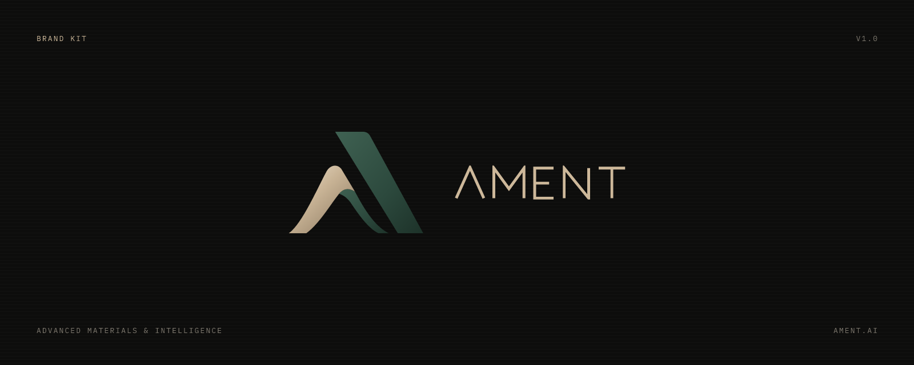
</p>

# AMENT Brand Kit

Official logos, colours, typography and guidelines for **AMENT** (Advanced Materials & Intelligence) and its
product **AMENT Hive**. Everything here matches what you see on [ament.ai](https://ament.ai) and in Hive.

> **Version 1.0.0** · [Changelog](CHANGELOG.md) · Questions: **support@ament.ai**

## Contents

| Folder | What's inside |
|---|---|
| [`logos/svg`](logos/svg) | Vector logos: mark, wordmark, horizontal and stacked lockups, AMENT Hive lockup |
| [`logos/png`](logos/png) | Transparent PNG exports of every SVG at 256, 512, 1024 and 2048px wide |
| [`logos/source`](logos/source) | Original raster concept renders of the logo |
| [`app-icons`](app-icons) | `favicon.svg`, `favicon.ico`, Apple touch icon, PWA icons, maskable icon |
| [`colors`](colors) | `tokens.json` (design tokens), `tokens.css`, `tailwind.css`, `palette.ase`, `palette.gpl`, swatch sheet |
| [`typography`](typography/README.md) | Typefaces, weights, embed snippets, type scale |
| [`guidelines`](guidelines/brand-guidelines.md) | Full brand guidelines: identity, logo usage, colour, voice, naming |
| [`index.html`](index.html) | A one-page visual overview of the kit (open locally or via GitHub Pages) |

## Quick downloads

| I need… | Use |
|---|---|
| The logo for a website header (dark) | [`ament-lockup-horizontal-on-dark.svg`](logos/svg/ament-lockup-horizontal-on-dark.svg) |
| The logo for a website header (light) | [`ament-lockup-horizontal-on-light.svg`](logos/svg/ament-lockup-horizontal-on-light.svg) |
| The logo for Word, Slides or Keynote | [`ament-lockup-horizontal-on-light-1024.png`](logos/png/ament-lockup-horizontal-on-light-1024.png) |
| A social media avatar | [`ament-lockup-stacked-on-dark.svg`](logos/svg/ament-lockup-stacked-on-dark.svg) on graphite `#0d0d0c`, or [`icon-512.png`](app-icons/icon-512.png) |
| The symbol only | [`ament-mark-color.svg`](logos/svg/ament-mark-color.svg) (dark bg) · [`ament-mark-mono-ink.svg`](logos/svg/ament-mark-mono-ink.svg) (light bg) |
| AMENT Hive | [`ament-hive-lockup-on-dark.svg`](logos/svg/ament-hive-lockup-on-dark.svg) · [`ament-hive-lockup-on-light.svg`](logos/svg/ament-hive-lockup-on-light.svg) |
| Colours in code | [`colors/tokens.css`](colors/tokens.css) · [`colors/tailwind.css`](colors/tailwind.css) · [`colors/tokens.json`](colors/tokens.json) |
| Colours in Adobe / Figma / GIMP | [`colors/palette.ase`](colors/palette.ase) · [`colors/palette.gpl`](colors/palette.gpl) |

To download everything, click **Code → Download ZIP** on GitHub.

## Logos

**On dark**

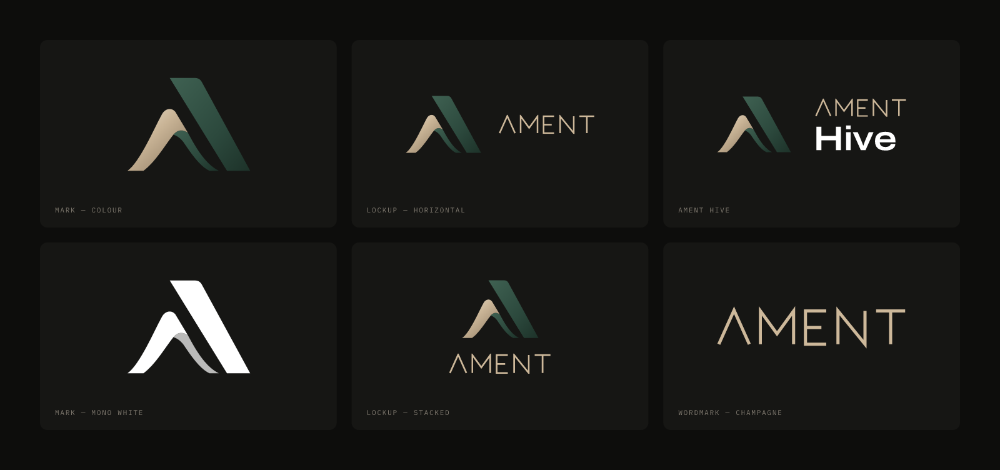

**On light**

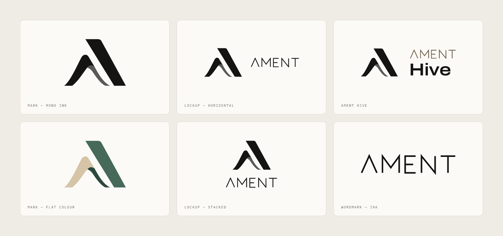

### Files

| Asset | On dark | On light | Mono |
|---|---|---|---|
| Mark | `ament-mark-color` | `ament-mark-mono-ink` | `ament-mark-mono-black`, `ament-mark-mono-white`, `ament-mark-color-flat` (small sizes) |
| Wordmark | `ament-wordmark-champagne` | `ament-wordmark-ink`, `ament-wordmark-champagne-deep` | `ament-wordmark-black`, `ament-wordmark-white` |
| Horizontal lockup | `ament-lockup-horizontal-on-dark` | `ament-lockup-horizontal-on-light` | `ament-lockup-horizontal-mono-black`, `ament-lockup-horizontal-mono-white` |
| Stacked lockup | `ament-lockup-stacked-on-dark` | `ament-lockup-stacked-on-light` | |
| AMENT Hive lockup | `ament-hive-lockup-on-dark` | `ament-hive-lockup-on-light` | |

Each name exists as `logos/svg/<name>.svg` and `logos/png/<name>-{256,512,1024,2048}.png`. All files have
transparent backgrounds: "on dark" files are meant to be placed **on** a dark surface.

### Concept renders

| File | Shows |
|---|---|
| [`ament-logo-stacked-metallic-tagline.png`](logos/source/ament-logo-stacked-metallic-tagline.png) | Mark in brushed gold and green leather-texture with a gold "AMENT" wordmark and a concept tagline, on white |
| [`ament-logo-stacked-green-flat.png`](logos/source/ament-logo-stacked-green-flat.png) | Flat single-colour deep green mark over the "AMENT" wordmark, on white |
| [`ament-mark-metallic.png`](logos/source/ament-mark-metallic.png) | The mark alone in brushed gold and green with gold edges, on white |

These show the spirit of the identity. **Use the vector files for anything produced.**

## Usage: do's and don'ts

| Do | Don't |
|---|---|
| Use the files as supplied and scale proportionally | Stretch, skew, rotate or re-proportion the logo |
| Use the colour mark on graphite or other calm dark surfaces | Put the colour mark on mid-tones, saturated colours or busy photos |
| Use the mono ink mark on light backgrounds | Recolour or swap the mark's champagne and green |
| Keep the clear space (X = wordmark height) | Add shadows, glows, outlines, bevels or 3D effects |
| Write "AMENT Hive", then "Hive" | Retype "AMENT" in a font, write "Ament Hive", or use the old honey hexagon |

### Clear space and minimum size


| Asset | Minimum digital | Minimum print |
|---|---|---|
| Mark (colour) | 24px tall | 8mm |
| Mark (flat / mono) | 16px tall | 5mm |
| Wordmark | 9px tall | 3mm |
| Horizontal lockup | 120px wide | 30mm wide |

## Colour

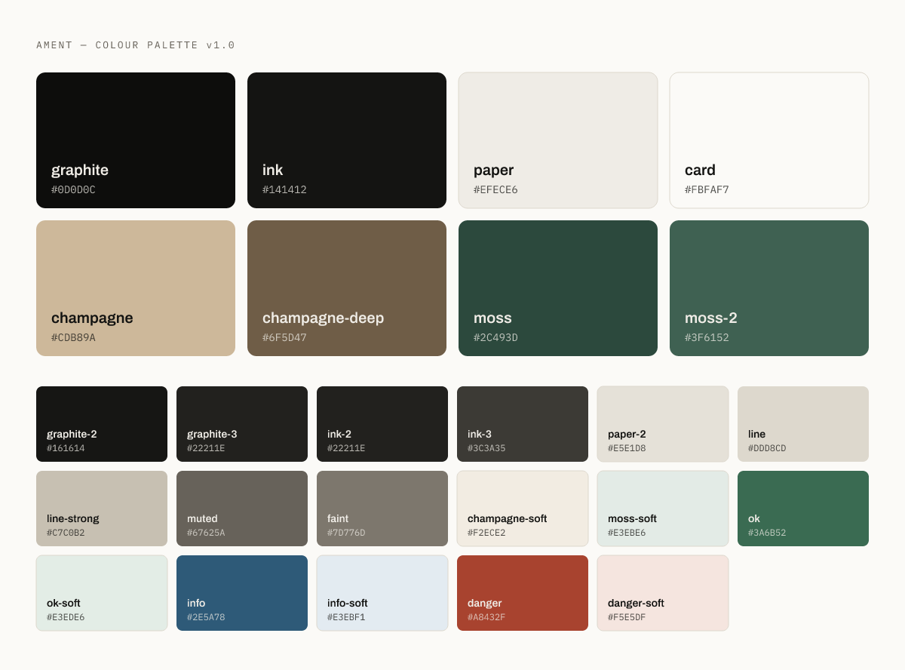

| | Token | HEX | RGB | Use |
|---|---|---|---|---|
| 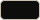 | `graphite` | `#0D0D0C` | 13 13 12 | Dark chrome, dark backgrounds |
| 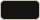 | `ink` | `#141412` | 20 20 18 | Text on light, primary buttons |
| 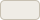 | `paper` (porcelain) | `#EFECE6` | 239 236 230 | Light canvas |
| 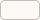 | `card` | `#FBFAF7` | 251 250 247 | Cards, inputs |
| 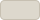 | `line` | `#DDD8CD` | 221 216 205 | Hairlines |
| 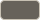 | `muted` | `#67625A` | 103 98 90 | Secondary text |
| 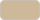 | `champagne` | `#CDB89A` | 205 184 154 | **The accent.** Fills and strokes. Text only on graphite |
| 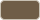 | `champagne-deep` | `#6F5D47` | 111 93 71 | Accent text and icons on light |
| 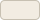 | `champagne-soft` | `#F2ECE2` | 242 236 226 | Tints, selection |
| 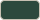 | `moss` | `#2C493D` | 44 73 61 | Brand green |
| 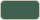 | `moss-2` | `#3F6152` | 63 97 82 | Brand green, lighter |
| 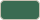 | `ok` | `#3A6B52` | 58 107 82 | Status: success |
| 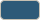 | `info` | `#2E5A78` | 46 90 120 | Status: information |
| 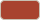 | `danger` | `#A8432F` | 168 67 47 | Status: error |

The full set (25 tokens, plus the mark's gradient stops) is in [`colors/tokens.json`](colors/tokens.json).
Rules: **one accent per view**, roughly 70% neutrals, 25% text and at most 5% accent. No gradients on surfaces
and no glows.

## Typography

| Typeface | Use | Licence |
|---|---|---|
| [**Archivo**](https://fonts.google.com/specimen/Archivo) (variable, `wdth` + `wght`) | Everything. Display style at 118% width, −0.02em tracking, weight 600 | SIL OFL 1.1 |
| [**IBM Plex Mono**](https://fonts.google.com/specimen/IBM+Plex+Mono) | Data and spec-sheet eyebrows: 11px, UPPERCASE, +0.16em tracking | SIL OFL 1.1 |

Details, embed snippets and the type scale are in [`typography/README.md`](typography/README.md).

## Using the tokens

```html
<link rel="stylesheet" href="colors/tokens.css">
<style>
  body { background: var(--ament-paper); color: var(--ament-ink); font-family: var(--ament-font-sans); }
  .accent { color: var(--ament-champagne-deep); }
</style>
```

Tailwind CSS v4: copy [`colors/tailwind.css`](colors/tailwind.css) under `@import "tailwindcss";` to get
`bg-graphite`, `text-champagne-deep`, `ring-line`, `font-display`, `t-eyebrow` and the rest.

## Türkçe özet

Bu depo, **AMENT** (İleri Malzemeler ve Yapay Zeka Teknolojileri) ve ürünü **AMENT Hive** için resmi marka
kitidir. Logoların vektör (SVG) ve şeffaf PNG sürümleri `logos/` klasöründe, uygulama ve favicon simgeleri
`app-icons/` klasöründe, renk kodları (CSS, Tailwind, JSON, Adobe ASE) `colors/` klasöründe, yazı tipleri
(Archivo ve IBM Plex Mono) `typography/` klasöründe yer alır. Ayrıntılı kullanım kuralları
[`guidelines/brand-guidelines.md`](guidelines/brand-guidelines.md) dosyasındadır.

Temel kurallar:

- Logoları olduğu gibi kullanın. Renklerini, oranlarını veya yazısını değiştirmeyin, efekt eklemeyin.
- Renkli işaret koyu (grafit) zeminde, tek renk (mürekkep) işaret açık zeminde kullanılır.
- Her ekranda tek vurgu rengi kullanın: şampanya (`#CDB89A`). Açık zeminde vurgulu metin için `#6F5D47` kullanın.
- Ürün adı ilk geçtiği yerde "AMENT Hive", sonrasında "Hive" olarak yazılır. Eski bal sarısı altıgen logo artık kullanılmaz.
- Ton: sade, net ve operasyonel. Ünlem, abartı ve emoji kullanılmaz.

Sorular ve izin talepleri için: **support@ament.ai**

## Licence

**Logos and marks: © 2026 AMENT. All rights reserved.** The AMENT name, the AMENT mark, the AMENT wordmark and
the AMENT Hive name and lockup are trademarks of AMENT. You may use the unmodified logo files to **refer to
AMENT or AMENT Hive** (for example in articles, partner listings or integrations). You may not modify them,
use them in your own product or company branding, or use them in a way that implies endorsement or
affiliation without written permission.

**Code and tokens** (`colors/*.css`, `colors/*.json`, `colors/*.gpl`, `colors/*.ase`, `index.html`) are
released under the MIT License, so you can use the values freely in your own code.

**Fonts** are not included. Archivo and IBM Plex Mono are licensed by their authors under the SIL Open Font License 1.1.

See [LICENSE](LICENSE) for the full text.
