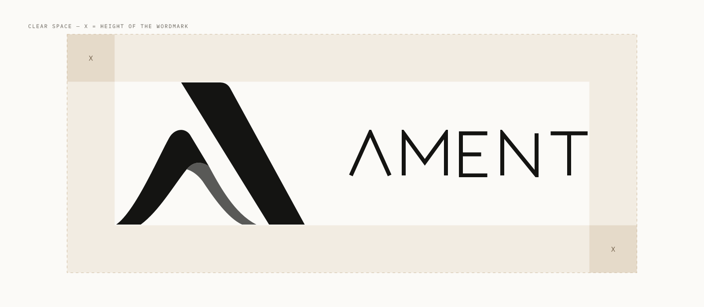

# AMENT brand guidelines

Version 1.0 · October 2026

## 1. Identity

**AMENT** (AMENT İleri Malzemeler ve Yapay Zeka Teknolojileri · *Advanced Materials & Intelligence*)
is a materials and AI company based in Samsun, Türkiye. It starts with premium 3D-printing
filament and is building toward advanced materials developed with data and AI.
Its first software product is **AMENT Hive**, an operating system for 3D print farms.

The brand should look **quiet, precise and industrial-premium**, like the software of a German
machine-tool maker rather than a startup dashboard. Restraint over decoration: few colours, plenty of space,
hairlines instead of boxes, and the precision of a technical data sheet.

### The mark

The mark is an abstract **A** made of two parts:

- a **champagne ribbon** that rises from the left foot, arches over the apex and folds under itself,
  showing its **green underside**, and
- a **deep green band** that forms the right stroke.

The ribbon stands for material being shaped, and the band for the precise, engineered side.
The vector geometry in [`/logos/svg`](../logos/svg) is the source of truth.
It is the same geometry used on ament.ai and in AMENT Hive.

### The wordmark

A geometric, monoline **AMENT**: crossbar-less A (echoing the mark), short-armed E, open spacing.
It is drawn, not typeset. Never recreate it with a font.

### Logo family

| Asset | Files | Use |
|---|---|---|
| Mark, colour | `ament-mark-color` | Primary mark on graphite or other dark, calm backgrounds |
| Mark, flat colour | `ament-mark-color-flat` | Small sizes (favicons, ≤ 32px), embroidery, print without gradients |
| Mark, mono | `ament-mark-mono-ink` / `-black` / `-white` | Light surfaces, single-colour print, engraving, watermarks |
| Wordmark | `ament-wordmark-*` | Headers, footers, packaging, anywhere the name must be read |
| Horizontal lockup | `ament-lockup-horizontal-*` | Default company signature: documents, slides, web headers |
| Stacked lockup | `ament-lockup-stacked-*` | Square formats: social avatars, packaging fronts, posters |
| AMENT Hive lockup | `ament-hive-lockup-*` | The Hive product only |

**On dark** (graphite) versions use the colour mark and a champagne wordmark.
**On light** (porcelain, white) versions use the mono ink mark and an ink wordmark. In the Hive lockup on light
the wordmark is champagne-deep. In mono marks the folded underside is drawn at 70% opacity. This is part of the
design, so keep it.

The colour mark is designed for dark backgrounds. Its champagne ribbon loses contrast on white. On light
surfaces, prefer the mono mark.

### Owner concept renders

[`/logos/source`](../logos/source) holds the original raster concept images (metallic gold and green, and a
flat green stacked version). They show the intended spirit of the mark and are suitable for mood boards and
presentations. **For production, always use the vector files.** The renders are not exact vector-accurate and
their tagline ("Advanced Materials & AI Technologies") is a concept wording. The official descriptor
is *Advanced Materials & Intelligence*.

## 2. Logo usage

### Clear space

Keep a margin of at least **X** on every side, where X is the height of the wordmark in the lockup
(for the mark alone: X = ⅓ of the mark height). No text, edges or other graphics may enter this zone.

### Minimum size

| Asset | Digital | Print |
|---|---|---|
| Mark (colour) | 24px tall | 8mm tall |
| Mark (flat colour / mono) | 16px tall | 5mm tall |
| Wordmark | 9px tall | 3mm tall |
| Horizontal lockup | 120px wide | 30mm wide |
| AMENT Hive lockup | 28px tall (mark height) | 10mm tall |

### Do

- Use the supplied files unchanged. Scale them proportionally.
- Place the colour mark on graphite (`#0d0d0c`) or a similarly calm dark surface.
- Use mono versions on photographs, busy or light backgrounds, and for single-colour production.
- Leave the clear space. When in doubt, use more space.

### Don't

1. Don't recolour the mark or swap its colours (for example a green ribbon with a champagne band).
2. Don't add effects: drop shadows, glows, bevels, outlines, 3D extrusions or textures in digital use.
   The metallic renders are concept art, not a style to apply.
3. Don't stretch, skew, rotate or change the proportions between mark and wordmark.
4. Don't retype the wordmark in Archivo or any other font, and don't add a crossbar to the A.
5. Don't place the colour mark on mid-tone or saturated backgrounds, or on busy photos without a calm area.
6. Don't put the logo inside a container shape (circle, badge, hexagon) except the app icons supplied here.
7. Don't combine the AMENT logo with other logos into a new lockup, and don't invent product lockups.
   Only the AMENT Hive lockup exists.
8. Don't use the retired honey-yellow hexagon logo (see §6).

## 3. Colour

The palette is warm graphite, porcelain, champagne and moss. Full tokens are in [`/colors`](../colors).

| Role | Tokens |
|---|---|
| Dark chrome | graphite `#0d0d0c`, graphite-2 `#161614`, graphite-3 `#22211e` |
| Text on light | ink `#141412`, ink-2 `#22211e`, ink-3 `#3c3a35`, muted `#67625a`, faint `#7d776d` |
| Light surfaces | paper (porcelain) `#efece6`, paper-2 `#e5e1d8`, card `#fbfaf7` |
| Hairlines | line `#ddd8cd`, line-strong `#c7c0b2` |
| Accent | champagne `#cdb89a`, champagne-deep `#6f5d47`, champagne-soft `#f2ece2` |
| Brand green | moss `#2c493d`, moss-2 `#3f6152`, moss-soft `#e3ebe6` |
| Status | ok `#3a6b52`, info `#2e5a78`, danger `#a8432f` (each with a `-soft` tint) |

### Proportions

Roughly **70% neutrals** (porcelain or graphite), **25% ink/text**, **≤ 5% accent**.

- **One accent per view.** Champagne marks the active, selected or most important thing.
- **Champagne text only on graphite.** On light surfaces champagne fails contrast. Use champagne-deep for
  accent text and icons there.
- **Green is brand and "ok"**, used for material, sustainability and success, not as decoration.
- **Status colours are muted and earthy, never neon.**
- **No gradients** on surfaces. The only gradients are inside the mark (and, if ever needed, a single
  champagne "metal" text gradient for a hero numeral). No coloured shadows, glows or glassmorphism.

## 4. Typography

**Archivo** (variable, with width axis) for everything; display style at 118% width with tight tracking.
**IBM Plex Mono** for data and spec-sheet eyebrows: UPPERCASE, 10–11px, +0.16em tracking.
See [`/typography`](../typography/README.md).

## 5. Shape, layout and motion

- **Radius:** cards 12px, controls 8px. Don't go rounder.
- **Surfaces:** porcelain canvas with warm-white cards, a 1px hairline and a barely-there shadow.
  Dark chrome is graphite with white hairlines at 6–10% opacity.
- **Hairlines over boxes; whitespace over dividers.**
- **Texture (optional, subtle):** fine horizontal "layer lines", like the wall of an FDM print, at 3–9% opacity.
- **Motion:** short and mechanical, 150–300ms, `cubic-bezier(0.2, 0.7, 0.2, 1)`. Layer-by-layer reveals
  (the print metaphor) are the signature motion, so use them sparingly. Always respect `prefers-reduced-motion`.

## 6. Product naming: AMENT Hive

- Write **"AMENT Hive"** on first mention and in titles, and **"Hive"** afterwards.
- Never write "Ament Hive", "AMENT HIVE" (except in all-caps eyebrows), "Hive by Ament" or "AmentHive".
- The company name is always **AMENT** in capitals.
- Hive's domain is `hive.ament.ai`. The company site is `ament.ai`.

**Retired:** Hive's earlier **honey-yellow hexagon icon and honey palette** are retired. Hexagon and honeycomb
*geometry* may remain as a subtle product motif (for example the farm-floor grid of printers), drawn as hairlines
in champagne or porcelain, but never as a yellow fill and never as a logo.

## 7. Voice and tone

Plain, confident and operational. Say what the machine is doing. Precise numbers over adjectives.
No exclamation marks, no hype, no emoji. Turkish and English are equal and kept in sync. Write each
natively rather than translating word for word.

| Instead of | Write (illustrative examples) |
|---|---|
| "Revolutionary AI-powered magic!" | "Printer 4 paused at layer 212: filament runout." |
| "Oops! Something went wrong 😕" | "The printer did not respond. Check that it is online and try again." |
| "Harika! Baskınız başladı! 🎉" | "Baskı başladı. Tahmini bitiş: 14:20." |
| "Dünyanın en iyi filamenti!" | "Çap ve nem değerleri teknik veri sayfasında." |

- **English:** sentence case for headings and buttons, with short verbs ("Start print", "Pause", "Assign").
- **Türkçe:** başlık ve butonlarda cümle düzeni. Kısa fiiller: "Baskıyı başlat", "Duraklat", "Ata".
  Use the formal "siz" form.
- Don't claim what isn't verified, such as certifications, partners, performance figures or availability.

## 8. Contact

Questions about the brand or permission requests: **support@ament.ai**
